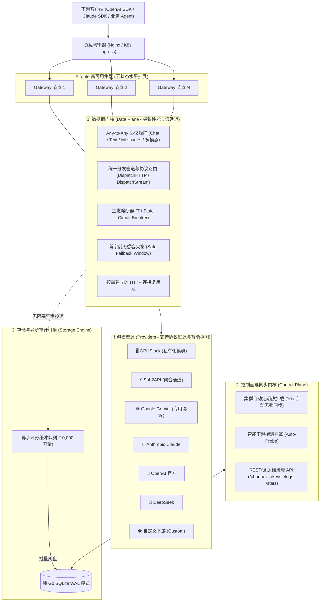

# Airoute 🚀

> **A self-hosted LLM gateway in Go.** Bidirectional OpenAI / Anthropic / Gemini protocol translation, multi-provider failover with circuit breaking, session affinity, and per-request cost & channel audit — one binary with an embedded React admin console, SQLite or PostgreSQL.

[](https://github.com/ifnodoraemon/airoute/actions/workflows/ci.yml)
[](https://github.com/ifnodoraemon/airoute/actions/workflows/docker.yml)
[](LICENSE)
[](https://goreportcard.com/report/github.com/ifnodoraemon/airoute)

生产级 LLM 与全模态智能网关，Go 语言构建。原生支持 **Any-to-Any 协议双向转译**（OpenAI ⇄ Anthropic ⇄ Gemini）、**级联模型命名与通配符前缀映射**、**下游智能探测自动建渠道**、**多渠道优先级 failover 与三态熔断**。

数据面（高并发转发内核）与控制面（运维治理）彻底解耦，单二进制内嵌现代化管理台（React 19 + Tailwind CSS），支持 SQLite 单机与 PostgreSQL 集群两种部署形态。

---

## 📚 完整文档索引 (Documentation)

- [📖 API 接口详尽参考手册 (API Reference)](docs/API_REFERENCE.md)
- [⚙️ 系统全量配置与调优指南 (Configuration & Tuning)](docs/CONFIGURATION.md)
- [🔌 供应商与下游对接指南 (Provider Integration Guide)](docs/PROVIDER_GUIDE.md)
- [🛡️ 高可用集群与容灾部署架构 (HA Architecture)](docs/HA_ARCHITECTURE.md)
- [📦 发版与镜像发布流程 (Release Guide)](docs/RELEASE_GUIDE.md)
- [📐 软件工程哲学与架构规范指南 (Engineering Guidelines)](docs/ENGINEERING_GUIDELINES.md)

---

## 🌟 核心特性与架构优势

### 1. 🔍 一键智能探测下游服务 (Downstream Auto-Probe)
- 只需输入下游服务的 Base URL 与可选 API Key，网关后台**毫秒级探测并自动读取**：
  - 自动发现所有挂载模型 ID；
  - 自动识别厂商类型（GPUStack、Sub2API、Google Gemini、Anthropic Claude、vLLM、Ollama）；
  - 自动匹配并勾选下游支持的协议与模态（对话、生图、TTS、Whisper、视频）；
  - 彻底免去用户手动配置模型列表与协议的繁琐操作。

### 2. 🔄 全双工协议自动转译 (Bidirectional Protocol Translation)
- **纯补全下游自动适应**：当下游模型仅支持传统的 `/v1/completions` 接口时，网关透明地将入站的 Chat 请求与 SSE 流转译为补全 Prompt，并将响应包装回标准 Chat Choices 与 SSE Deltas。
- **Claude Messages 接入**：原生 Anthropic 渠道保留签名思考块、缓存标记和 SSE 事件；普通文本与工具调用可转译到兼容渠道。需要原生语义的请求只路由到 Anthropic 渠道。
- **Gemini 原生格式转译**：官方 Gemini Developer API 专用协议透明转译，支持多模态多轮会话。

### 3. 🎨 文本/图像/语音/视频全模态支持 (Unified Multimodal Pipeline)
- **对话、智能体响应与补全**：`/v1/chat/completions`, `/v1/responses` (OpenAI 官方新代智能体协议), `/v1/completions`, `/v1/messages`
- **AI 图像生成**：`/v1/images/generations`（DALL-E 3、Flux、SD3）
- **语音合成 TTS**：`/v1/audio/speech`（响应体流式转发）
- **语音识别 STT**：`/v1/audio/transcriptions`（Whisper Multipart 流式转录）
- **视频生成与轮询**：`/v1/videos/generations`, `/v1/videos/tasks/:id`（Sora / CogVideoX 异步任务轮询）
- 所有模态均采用**软件工程 Strategy 统一管道 (`DispatchHTTP`)**，共享三态熔断与安全容灾。

### 4. 🔗 级联模型源与无限制模型命名 (Cascading Models & Namespaces)
- **多层级斜杠无限制支持**：下游模型形如 `xxx/xx`，对外可任意包装为 `yy/xxx/xx`、`org/team/project/model` 或任意级联路径，网关不设任何层级限制。
- **通配符前缀映射 (Prefix Wildcards)**：支持配置 `"yy/*": "*"` 或 `"org/dept/*": "*"`，自动完成前缀剥离与转发重写。
- **自动渠道名称前缀匹配**：当请求模型形如 `<provider_name>/<upstream_model>` 时，网关自动定位该 Provider 并透明透传 `<upstream_model>`。

### 5. ⚡ 转发与审计 (Forwarding & Audit)
- **内存路由缓存**：渠道与密钥配置热加载到内存；计费及控制面仍可能访问数据库。
- **连接复用**：HTTP Transport 最多保留 2048 个空闲连接，每个 Host 最多 512 个；连接按需建立，支持 HTTP/2。
- **异步审计**：默认使用 10000 容量队列并定期批量入库；数据库写入失败会保留批次重试，队列满时先把记录落到本地 spill 文件（`GATEWAY_USAGE_SPILL_DIR`）并在下次启动/下一轮重放；只有落盘也失败才会丢弃并计入 `airoute_usage_log_records_dropped_total`（不再对请求施加背压）。

### 6. 🛡️ 极致高可用与容灾 (Extreme High Availability)
- **三态智能熔断器 (Tri-State Circuit Breaker)**：每个 Provider 独立跟踪健康度。默认连续 3 次渠道故障（401/403/408、5xx、网络错误/超时）后熔断 30 秒并进入半开探活；**HTTP 429 不计入渠道故障**（作为可退避的背压直接透传）。单渠道部署可设 `GATEWAY_BREAKER_ENABLED=false` 进入 advisory 模式（只记录不拦截）。
- **首字前容灾窗 (Safe Fallback Window)**：首个内容分块或工具调用前发生上游错误时尝试备用渠道；切换耗时取决于上游和超时配置。
- **集群 10 秒定期无锁自同步**：任意实例修改配置，多副本集群后台自动热重载，无需人工重启服务。

### 7. 💰 供应商模型单价维护与售价并排 (Supplier Prices Beside Our Sell Price)
- **定价页并排展示**：定价页「供应商单价」子视图按**模型**把**我们的售价**与**供应商模型单价**并排显示，并标出价差（我们的售价 − 供应商价）；两套价目**分开维护、互不推导**（我们的售价 ≠ 供应商价）。供应商价未配置时显示“未配置”，不按 0 计算。
- **售价体系不变**：沿用四级价目解析（分组 → default → 通配符 → `*`）与缓存/分时/分组计价。
- **供应商价目维护与批量导入**：按「渠道名 + 模型」维护输入/输出每百万 token 的供应单价与启用状态；支持 CSV 导出与导入（表头识别、`dry_run=1` 预览、逐行错误、全量校验通过后写入）。
- **口径说明**：供应商单价仅用于比价与议价参考，不参与扣款、不写成本字段、不计算毛利；组织与成本中心、预算与告警、钱包资金流水、成本与毛利不在产品范围内（见[范围裁剪记录](docs/design/v1.1-scope-cut-2026-10-28.md)）。

---

## 🏛️ 系统架构图



---

## 🚀 极速部署指南

### 方式 A: 预编译二进制直接运行
```bash
# 1. 编译自包含单二进制（包含内嵌 Web UI）
make build

# 2. 启动网关（配置文件必须存在；缺失会直接报错退出，不再回退默认配置）
#    启动前必须设置强管理员凭证，否则进程会拒绝启动（fail-closed）：
export GATEWAY_ADMIN_PASSWORD='<至少 16 位随机口令>'
export GATEWAY_ADMIN_SECRET='<至少 32 位随机字符串>'
./bin/airoute -config configs/config.yaml

# 仅一次性本地开发可跳过凭证要求（生产环境绝不能这样做）：
# GATEWAY_ALLOW_INSECURE_DEFAULTS=true ./bin/airoute -config configs/config.yaml
```
- 工作台地址：`http://localhost:8080/app/` 或 `http://localhost:8080/`
- Prometheus 指标：`http://localhost:8080/metrics`
- 健康检查：`http://localhost:8080/health`

### 方式 B: Docker Compose 多副本高可用集群
```bash
# 先从 .env.example 创建 .env，并填写管理员、PostgreSQL 与对象存储密钥及匹配的 DATABASE_URL
# 然后启动 2 副本 Gateway + Nginx 负载均衡器
docker compose up -d --build

# 推荐：按当前提交重建镜像（二进制报告 1.1.0-dev+g<commit>）并滚动重启两个副本
make docker-rebuild
```
Nginx 会自动在 `http://localhost:8080` 暴露统一入口（宿主端口由 `.env` 的 `GATEWAY_INGRESS_PORT` 决定，默认 8080，映射到容器 80），并以 `least_conn` 算法向双节点分发流量，自动关闭 SSE 缓冲 (`proxy_buffering off`)。Compose/Swarm/Helm 都会以 release 语义启动，弱管理员凭证会直接拒绝启动。

> **控制面暴露说明**：`deploy/nginx-compose.conf` 里 `api.*` 主机的 `/api/v1/admin` 403 只是按 Host 的**路由**约定，不是安全边界（客户端可以伪造 Host 或直接走默认 vhost / IP，控制台因此保持可用）。生产环境请把 LB 端口绑定到 `127.0.0.1`（`ports: ["127.0.0.1:8080:80"]`）或放入 VPN/防火墙之后；网关自身仍会对每个 `/api/v1/admin` 请求做认证与管理员鉴权。

### 方式 C: Kubernetes Helm Chart 部署
```bash
# 默认单副本 SQLite；管理员密码和签名密钥由 Chart Secret 生成
helm install airoute ./helm/airoute -n gateway --create-namespace
# 查看生成的管理员密码（请妥善保管 Secret）
kubectl get secret airoute-auth -n gateway -o jsonpath='{.data.admin-password}' | base64 -d
```

---

## 🧪 自动化测试体系

### 1. 单元与组件集成测试 (Unit & Component Tests)
无需外部依赖，全部核心逻辑均在并发竞态检测 (`-race`) 模式下运行：
```bash
make test
```
包含：
- API 健康度与 Prometheus `/metrics` 校验
- 控制面动态 CRUD 与数据面热重载
- 级联模型命名与通配符前缀剥离 (`TestCascadingAndUnrestrictedModelMapping`)
- 三态智能熔断器状态机跃迁 (`CLOSED -> OPEN -> HALF-OPEN -> CLOSED`)
- 首字前无感容灾窗口（非流式与流式）
- Google Gemini 协议与 Anthropic Claude 双向流式转换
- 多模态生图、TTS、Whisper STT 与视频生成管道
- 纯文本补全下游全双工协议转译与智能探测 (`TestAutoProbe_OpenAIAndGPUStack`)

### 2. 服务启动后的集群端到端测试 (Cluster End-to-End Tests)
在服务或 Docker Compose 集群启动后，一键对真实运行环境进行全链路验收：
```bash
# 启动集群
docker compose up -d

# Go 原生 E2E 驱动套件
make test-e2e-go
# 或：go test -v -tags=e2e ./tests/e2e/...
```

E2E 套件覆盖的 8 大核心验收维度（共 25 项自动化测试）：
1. **集群健康 & Web 入口**：负载均衡器 `/health` (healthy)、状态探针 `/api/v1/public/status`、SPA HTML 渲染
2. **安全边界 & 鉴权校验**：非鉴权拦截 (401)、错误口令拒绝、Admin JWT 签发与 `/api/v1/auth/me` 身份自省
3. **MCP 生态集成**：内置 15 款核心 MCP 服务器（Dev / Search / Data / AI / Ops / Enterprise）元数据核验与动态启停
4. **Skills Hub & 边缘缓存**：Skill ZIP 包网关权威流式下载（PK 结构校验）与 Nginx 边缘缓存 (`X-Cache-Status: HIT`)
5. **模型拓扑与计费引擎**：[运行时容灾拓扑](docs/ROUTING_TOPOLOGY.md)、真实渠道验证、审计切换记录与分级计费规则
6. **密钥治理与节点热同步**：虚拟密钥动态签发、配额设置与 Redis Pub/Sub 多节点毫秒级同步
7. **数据面代理与分布式追踪**：`/v1/models`、`/v1/chat/completions` 与全链路 `X-Airoute-Trace-Id` 注入校验
8. **高可用并发稳定性**：高并发批量探针零丢包、负载均衡无损转发验证

---

## 📄 开源许可证

本项目基于 [MIT 许可证](LICENSE) 开源。
